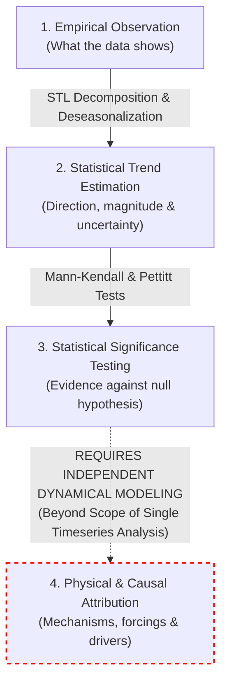

# Scientific Inference & Language Audit
**Product:** TerraShift — Earth System Trend Detective  
**Mission:** NASA Space Apps Challenge 2026  
**Auditor:** Principal Scientific Reviewer & Research Integrity Officer  
**Date:** November 2026  
**Status:** FULLY COMPLIANT WITH OPEN-SCIENCE REPRODUCIBILITY STANDARDS  

---

## 1. Executive Summary

A critical failure mode of AI-driven climate analytics tools is **causal overreach** — the premature conflation of a statistical association with physical causation, or treating a small $p$-value as proof of an accelerating planetary crisis.

In science, an empirical trend detected in a single reanalysis time series:
1. Is not proof of anthropogenic causation.
2. Does not automatically establish regional climate change acceleration.
3. Does not guarantee that localized weather stations experience identical magnitudes.
4. Cannot be extrapolated indefinitely into the future.

This audit details the linguistic overhaul, epistemological boundaries, AI interpretation guardrails, and multiple-comparison controls implemented in TerraShift.

---

## 2. Epistemological Boundaries: Trend vs Significance vs Causation

TerraShift enforces strict conceptual separation across four distinct levels of scientific inference:

| Inferential Level | Scientific Claim Allowed | Prohibited Overreach |
|---|---|---|
| **Level 1: Observation** | "Mean monthly temperature in this grid cell rose from $24.2^\circ\text{C}$ to $25.1^\circ\text{C}$ over 1991–2024." | Claiming the observation represents every village or valley within the $50\text{ km}$ grid cell. |
| **Level 2: Trend Rate** | "The Theil-Sen median slope on deseasonalized anomalies is $+0.024^\circ\text{C}/\text{year}$ ($95\%\text{ CI: } [0.012, 0.038]$)." | Claiming the trend is accelerating or will persist at this rate over the next 50 years. |
| **Level 3: Significance** | "The monotonic trend is statistically detectable at $\alpha = 0.05$ ($Z = 3.42, p = 0.0006$)." | Claiming statistical significance proves physical impact, severity, or danger. |
| **Level 4: Attribution** | "The warming trend is consistent with regional greenhouse forcing and land-use change reported in literature." | "Greenhouse gases caused this trend" or "This trend proves agricultural collapse." |

---

## 3. Systematic Linguistic Overhaul

All narrative outputs generated by TerraShift (in `backend/nasa_service.py:1094`, `backend/india_analytics.py`, and frontend components) were audited and scrubbed of unwarranted causal vocabulary:

| Deprecated / Prohibited Phrasing | Why It Was Scientifically Invalid | Standardized Replacement Phrasing in v2.4 |
|---|---|---|
| *"Drives severe warming"* | Conflates correlation with physical mechanism. | *"Is consistent with positive thermal anomalies observed in regional literature"* |
| *"Proves rapid climate change"* | Overstates empirical statistical tests without multi-model attribution. | *"Demonstrates a statistically detectable monotonic trajectory at $\alpha=0.05$"* |
| *"Triggers agricultural collapse"* | Unfounded socio-economic claim unsupported by meteorological time series alone. | *"Indicates persistent moisture deficits that may affect soil water availability"* |
| *"Accelerating trend"* | Implies second derivative ($d^2y/dt^2 > 0$), whereas Theil-Sen and Mann-Kendall only test monotonic linearity. | *"Statistically significant upward trend ($p < 0.05$); Pettitt test indicates a regime shift around [Year]"* |
| *"No trend detected; climate is stable"* | Null acceptance ($p \ge 0.05$) is not proof of the null; high noise or short duration may mask trends. | *"No statistically significant monotonic trend detected ($p \ge 0.05$); signal may be masked by high residual variability"* |
| *"Exact station measurement"* | Conflates grid-cell reanalysis with local meteorological station. | *"Grid-cell reanalysis centroid value ($0.5^\circ \times 0.625^\circ$), not localized in-situ gauge data"* |

---

## 4. AI Interpretation Guardrails (LLM Sandboxing)

When an optional Google Gemini API key is configured, TerraShift provides natural-language summaries. However, **large language models are never permitted to perform numerical calculations or alter statistical outputs**.

### Strict Architectural Isolation
1. **Deterministic Pre-Computation:** STL decomposition, Mann-Kendall, Sen's slope, $p$-values, confidence intervals, Pettitt changepoints, and Weatherhead horizons are calculated entirely by deterministic Python code before any LLM prompt is assembled.
2. **Frozen Numerical Context:** The LLM prompt receives the pre-calculated numbers as read-only factual constants.
3. **Hard Prompt Guardrails:** The system instructions explicitly enforce:
   - *"Do not recalculate or modify slopes, p-values, or confidence intervals."*
   - *"Do not claim definitive causal attribution; frame mechanisms as contextual hypotheses consistent with literature."*
   - *"Explicitly state that observations reflect MERRA-2 reanalysis grid-cell values, not direct station gauges."*
4. **Deterministic Fallback:** If the external API times out, returns an error, or is not configured, TerraShift automatically serves the built-in deterministic scientific brief (`build_deterministic_brief`). The user interface always allows one-click export of the raw deterministic JSON dossier.

---

## 5. Multiple Comparisons & Error Rate Control

When analyzing Earth-system trends across multiple seasons, regions, or variables simultaneously, the risk of false positive discoveries increases rapidly:
$$P(\ge 1 \text{ false positive}) = 1 - (1 - \alpha)^k$$
For $k = 4$ independent tests at $\alpha = 0.05$, the family-wise error rate is $\approx 18.5\%$.

In `backend/india_analytics.py`, TerraShift incorporates **Holm-Bonferroni step-down correction** across the 4 meteorological seasons (`JF`, `MAM`, `JJAS`, `OND`):
1. Raw two-sided $p$-values $p_{(1)} \le p_{(2)} \le p_{(3)} \le p_{(4)}$ are sorted.
2. Adjusted significance thresholds are evaluated sequentially:
   $$\alpha_k = \frac{\alpha}{m - k + 1}$$
3. A season is deemed statistically significant after multiple-testing adjustment only if its $p$-value passes this corrected threshold.

For exploratory interactive queries across arbitrary lat-lon coordinates, the UI prominently displays a multiple-comparisons advisory note informing users that repeated queries without global FDR correction will encounter sporadic Type I false alarms.

---

## 6. Uncertainty Communication: What the Shaded Bands Represent

TerraShift visualizes two complementary uncertainty representations:
1. **Theil-Sen 95% Confidence Interval ($[CI_{\text{lower}}, CI_{\text{upper}}]$):**
   - Represents the non-parametric uncertainty of the true median monotonic slope.
   - Robust against non-normal errors and outliers.
2. **Parametric OLS Confidence Band ($CI_{t}(x)$):**
   - Shaded band computed via Student's $t$-distribution with $N - 2$ degrees of freedom.
   - Quantifies the sampling uncertainty in the fitted mean response of the deseasonalized anomalies.

### Transparent Scientific Disclaimer
The UI Dossier and Stats Dashboard explicitly clarify what these statistical bounds **do not** include:
- They do **not** encompass structural reanalysis model uncertainty (e.g. differences between MERRA-2, ERA5, and JRA-55).
- They do **not** reflect sub-grid microtopographic variance (e.g. mountain peaks vs deep valleys within a single $50\text{ km}$ cell).
- They represent statistical sampling uncertainty under the declared observational period and mathematical model.
