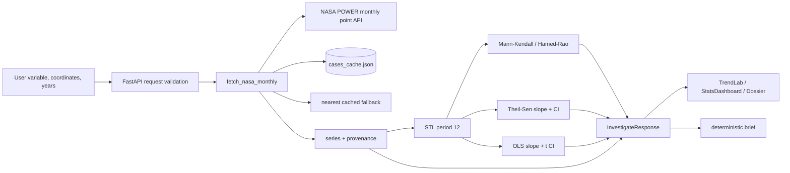

# Scientific Provenance Audit

## Scope

This audit follows the primary analysis path:

## Verified sources

| Provider/product | Code path | Status | Verified metadata |
|---|---|---|---|
| NASA POWER Monthly Point API | `backend/nasa_service.py:593` | Verified live and cached | Endpoint, API `v2.10.0`, monthly resolution, MERRA-2 meteorological source |
| NASA POWER AG community | `backend/nasa_service.py:48` | Verified | Used for the six configured variables; response units are community-specific |
| NASA MERRA-2 products | `backend/nasa_service.py:52` | Verified as the POWER meteorological source | Product family is recorded per variable, but POWER remains the serving API |
| NASA CMR/AppEEARS/NOAA/CSA/KNMI links | `backend/nasa_service.py:731` and `fetch_partner_intel` | Discovery/manual import only | These links do not make their data part of an analysis until a user imports a file |
| Acquisition catalog and CMR clients | `backend/acquisition/` | Implemented; live CMR can be unavailable | Dataset IDs, formats, auth requirements, QC profile, and storage path are retained |
| Synthetic demo waveform | `backend/nasa_service.py:1038`, import UI | Explicitly labeled | Never presented as NASA observations |
| India GeoJSON boundaries | `data/boundaries/` | Local authoritative geometry inputs | Region level, boundary file, vertex count, and polygon mask are reported |

## Lineage record

`build_series_provenance` now carries:

- source and source name
- NASA POWER access endpoint when applicable
- collection/product family
- variable and units
- temporal and spatial resolution
- requested and actual/source coordinates
- observation start/end
- retrieval status and fallback distance
- synthetic flag
- a note explaining grid-cell versus point interpretation

Cached preset cases now preserve the recorded `power_header`, including the API version and exact source label, rather than replacing it with generic metadata.

## Provenance gaps

- NASA POWER does not expose a unique per-request dataset DOI in the response used here; the API endpoint and product family are recorded instead.
- Retrieval timestamps are not present in the historical cache entries. Cache status is explicit, but exact acquisition time for those entries is unavailable.
- A NASA POWER point response represents a grid-cell value, not a station observation. The UI now states this.
- Contextual datasets listed in case descriptions (GPM, IMD, MODIS, AIRS, GRACE) are references, not silently combined inputs.
- Imported files depend on the uploader's metadata. Their source, units, and spatial support cannot be independently verified by TerraShift.
- Live CMR discovery depends on the external NASA service and may fail with an upstream 5xx without invalidating local statistical tests.

## Scientific function inventory

| Stage | Functions | Main assumptions |
|---|---|---|
| Request validation | Pydantic models in `backend/main.py` | India coordinate bounds for investigation requests; year bounds |
| NASA ingestion | `fetch_nasa_monthly`, `_parse_power_monthly_payload` | Monthly POWER response, API units, `-999`-style fill values |
| Cache/fallback | `_load_cache`, `_save_cache_atomic`, `_find_nearest_cached` | Nearest cached source is valid only within configured 500 km radius |
| Regularization | `_prepare_series` | Monthly observations; gaps of at most three consecutive months may be linearly interpolated |
| Seasonality | `_analyze_single` and `STL(period=12, robust=True)` | Monthly annual seasonality; STL residual represents deseasonalized variation |
| Trend tests | `mann_kendall_test`, `sens_slope` | Monotonic trend test; Hamed–Rao adjustment for rank autocorrelation |
| Parametric fit | `scipy.stats.linregress` | Equal monthly spacing after regularization; independent, homoscedastic residuals for t CI |
| Spatial acquisition | `extract_polygon_subset` | WGS84 lon/lat coordinates and cosine-latitude area weighting |
| Interpretation | `build_deterministic_brief`, optional Gemini | Contextual hypotheses only; numerical results remain deterministic |
| Presentation | `TrendLab`, `StatsDashboard`, `DossierModal` | User sees units, period, source/status, quality, limitations, and method |

