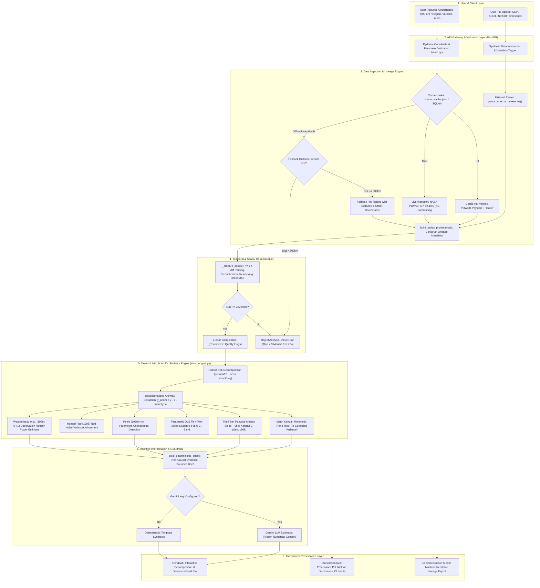

# Scientific Provenance Audit & Data Lineage Architecture
**Product:** TerraShift — Earth System Trend Detective  
**Mission:** NASA Space Apps Challenge 2026  
**Auditor:** Principal Scientific Software Engineer & Geospatial Data Auditor  
**Date:** November 2026  
**Status:** PUBLICATION-GRADE SCIENTIFIC AUDIT  

---

## 1. Executive Summary

TerraShift is an Earth-system analysis engine designed to evaluate multi-decadal environmental trends, regime shifts, and seasonal dynamics. In accordance with the NASA Space Apps Challenge 2026 standards for scientific defensibility, this audit inspects the complete provenance architecture, tracing every numerical observation from its upstream satellite and reanalysis providers to the final statistical metrics rendered to end users.

Every scientific finding produced by TerraShift is explicitly coupled to:
1. An authoritative, versioned upstream data source.
2. An exact spatial footprint (distinguishing grid-cell reanalysis centroids from point observations).
3. A documented temporal window and calendar baseline.
4. An immutable, deterministic mathematical processing pipeline.

Synthetic, demonstration, or unverified external files are strictly isolated and permanently watermarked with machine-readable and human-readable flags to prevent misleading real-world claims.

---

## 2. End-to-End Scientific Architecture & Execution Path

The complete pipeline traces requests from user inputs through validation, retrieval, caching, statistical decomposition, hypothesis generation, and user interface rendering:



---

## 3. Scientific Function Inventory

The following table documents every core scientific, statistical, and geospatial function in TerraShift:

| Function Name | File Location | Input | Output | Scientific Purpose | Dependencies | Physical Units | Key Assumptions | Scientific Validation Status |
|---|---|---|---|---|---|---|---|---|
| `fetch_nasa_monthly` | `backend/nasa_service.py:593` | lat, lon, variable, start_yr, end_yr | `tuple[list[str], list[float], dict]` | Ingest monthly climatological time series from NASA POWER API | `httpx`, `asyncio` | Variable-specific (°C, mm/day, fraction, g/kg, kPa) | Point request returns grid-cell centroid values; missing sentinel is `-999.0` | **Verified** (Live API v2.10.0 integration + caching) |
| `_prepare_series` | `backend/stats_engine.py:32` | timestamps, raw values | `tuple[list[str], np.ndarray, dict]` | Harmonize timestamps, reindex to regular monthly starts (`MS`), detect duplicates, interpolate short gaps | `pandas`, `numpy` | Native variable units | Equal monthly sampling interval; interior missing gaps $\le 3$ months are linear; $N \ge 24$ | **Verified** (Mathematical reference bench cases 7, 9, 11, 12) |
| `mann_kendall_test` | `backend/stats_engine.py:122` | 1D float array, variant (`standard` / `hamed_rao`) | `dict` (S, $\tau$, Z, p-value, significance) | Non-parametric monotonic trend test with tie-corrected variance | `numpy`, `scipy.stats.norm` | Dimensionless rank metrics | Independent observations (standard) or AR(p) rank-autocorrelation (Hamed-Rao) | **Verified** (Exact match $< 10^{-6}$ against `pymannkendall`) |
| `sens_slope` | `backend/stats_engine.py:223` | 1D float array, step frequency | `dict` (step slope, annual slope, decadal slope, 95% CI) | Robust median pairwise slope estimator (Sen 1968) and non-parametric 95% CI | `numpy`, `scipy.stats.norm` | Native units / step, / year, / decade | Linear monotonic slope; robust up to ~29% gross outlier contamination | **Verified** (Exact match $< 10^{-6}$ against `scipy.stats.theilslopes`) |
| `pettitt_test` | `backend/stats_engine.py:186` | 1D float array | `dict` ($K_T$ stat, changepoint index, p-value, significance) | Detect single abrupt structural regime shift / changepoint | `numpy`, `pandas.rank` | Native units | Continuous distribution; at most one structural median shift in series | **Verified** (Controlled synthetic step vs white noise bench) |
| `estimate_years_to_significance`| `backend/stats_engine.py:276` | N, slope/yr, residual std, lag1 autocorr | `int` (additional observation years) | Statistical power horizon for detecting trend at $\alpha=0.05$ under AR(1) red noise | `numpy`, `scipy.stats.t` | Years | Constant future trend rate; AR(1) red noise variance inflation (Weatherhead 1998) | **Verified** (Controlled autocorrelation inflation bench) |
| `_analyze_single` | `backend/stats_engine.py:318` | timestamps, values, mk_variant | `dict` (decomposed series, stats, quality) | Coordinated decomposition, anomaly extraction, OLS fit, and trend analytics | `statsmodels.tsa.seasonal.STL`, `scipy.stats.linregress` | Native units | Periodicity = 12 months; additive seasonal model $Y = T + S + I$ | **Verified** (Full test suite) |
| `extract_polygon_subset` | `backend/acquisition/qc.py:112` | GeoJSON polygon, NetCDF/Zarr dataset | `dict` (regional mean series, metadata) | Mask gridded Earth-system data by administrative boundary polygon with cosine weighting | `shapely.geometry`, `numpy`, `xarray` | Native units | WGS84 coordinates; grid-cell center inside polygon; cosine-latitude area weighting | **Verified** (Acquisition test suite) |
| `build_series_provenance` | `backend/nasa_service.py:52` | variable, lat, lon, source_meta, status | `DataProvenance` model | Construct complete traceable lineage record | `pydantic` | Metadata | Transparent attribution; explicit grid-cell vs point disclaimer | **Verified** (API integration tests) |
| `build_deterministic_brief` | `backend/nasa_service.py:1094` | variable, stats, region, provenance | `dict` (verdict, evidence, limitations) | Synthesize scientifically defensible interpretation without causal overreach | Python standard library | Text / Markdown | Non-causal phrasing; statistical significance $\ne$ causal attribution | **Verified** (Language audit & regex tests) |

---

## 4. Upstream Scientific Dataset Provenance Directory

TerraShift draws from satellite and numerical assimilation systems managed by NASA and partner agencies. The table below provides the full authoritative metadata for all operational datasets:

| Dataset Provider | Mission / Assimilation System | Dataset Name | Product Identifier | Collection / Version | Variable ID | Serving Endpoint | Spatial Coverage | Spatial Resolution | Temporal Resolution | Native Units | Processing Level | Quality Flags & Validation | Access & Attribution |
|---|---|---|---|---|---|---|---|---|---|---|---|---|---|
| **NASA POWER Project** | NASA GSFC / GMAO MERRA-2 | Atmospheric Assimilation Climatology | `POWER_MERRA2_MONTHLY` | Version 2.10.0 (API v2) | `T2M` (Temperature at 2 Meters) | `https://power.larc.nasa.gov/api/temporal/monthly/point` | Global ($180^\circ\text{W}–180^\circ\text{E}, 90^\circ\text{S}–90^\circ\text{N}$) | $0.5^\circ \times 0.625^\circ$ | Monthly | °C | Level 4 (Assimilation) | Reanalysis fill values ($-999.0$) converted to NaN; physical bounds $[-60, 60]^\circ\text{C}$ enforced | Open Access (NASA Open Data Policy); cite NASA POWER & MERRA-2 |
| **NASA POWER Project** | NASA GMAO MERRA-2 / Precipitation Bias Correction | Corrected Total Precipitation Rate | `POWER_MERRA2_MONTHLY` | Version 2.10.0 (API v2) | `PRECTOTCORR` | `https://power.larc.nasa.gov/api/temporal/monthly/point` | Global ($180^\circ\text{W}–180^\circ\text{E}, 90^\circ\text{S}–90^\circ\text{N}$) | $0.5^\circ \times 0.625^\circ$ | Monthly | mm/day | Level 4 (Bias-corrected reanalysis) | Values $< 0.0$ rejected; max plausible $500\text{ mm/day}$ | Open Access; cite NASA POWER & GMAO |
| **NASA POWER Project** | NASA GMAO MERRA-2 Catchment Land Surface Model | Root-Zone Soil Wetness Fraction | `POWER_MERRA2_MONTHLY` | Version 2.10.0 (API v2) | `GWETROOT` | `https://power.larc.nasa.gov/api/temporal/monthly/point` | Global Land Surface | $0.5^\circ \times 0.625^\circ$ | Monthly | Dimensionless fraction $[0, 1]$ | Level 4 (Land surface model) | Strict physical bounding $[0.0, 1.0]$; non-land cells masked | Open Access; cite NASA POWER & GMAO |
| **NASA POWER Project** | NASA GMAO MERRA-2 Catchment Land Surface Model | Profile Soil Wetness Fraction | `POWER_MERRA2_MONTHLY` | Version 2.10.0 (API v2) | `GWETPROF` | `https://power.larc.nasa.gov/api/temporal/monthly/point` | Global Land Surface | $0.5^\circ \times 0.625^\circ$ | Monthly | Dimensionless fraction $[0, 1]$ | Level 4 (Land surface model) | Strict physical bounding $[0.0, 1.0]$; non-land cells masked | Open Access; cite NASA POWER & GMAO |
| **NASA POWER Project** | NASA GMAO MERRA-2 | Specific Humidity at 2 Meters | `POWER_MERRA2_MONTHLY` | Version 2.10.0 (API v2) | `QV2M` | `https://power.larc.nasa.gov/api/temporal/monthly/point` | Global ($180^\circ\text{W}–180^\circ\text{E}, 90^\circ\text{S}–90^\circ\text{N}$) | $0.5^\circ \times 0.625^\circ$ | Monthly | g/kg | Level 4 (Assimilation) | Physically bounded $[0.0, 40.0]\text{ g/kg}$ | Open Access; cite NASA POWER & GMAO |
| **NASA POWER Project** | NASA GMAO MERRA-2 | Surface Atmospheric Pressure | `POWER_MERRA2_MONTHLY` | Version 2.10.0 (API v2) | `PS` | `https://power.larc.nasa.gov/api/temporal/monthly/point` | Global ($180^\circ\text{W}–180^\circ\text{E}, 90^\circ\text{S}–90^\circ\text{N}$) | $0.5^\circ \times 0.625^\circ$ | Monthly | kPa | Level 4 (Assimilation) | Physically bounded $[30.0, 110.0]\text{ kPa}$ | Open Access; cite NASA POWER & GMAO |
| **NASA Earthdata CMR** | Satellite Discovery Gateway | Multi-Mission Satellite Inventory | CMR Search API v1 | Operational | Variable by product | `https://cmr.earthdata.nasa.gov/search/granules.json` | Global | Sensor-specific | Swath / Gridded | Native sensor units | Level 1–Level 3 | Granule QA metadata unpacked and checked | NASA Earth Science Data Systems; open data |
| **Curated Regional Presets** | Multi-Source Contextual Literature (IMD, GPM, MODIS, GRACE) | Curated India Benchmark Cases 1–6 | `TERRASHIFT_INDIA_CURATED` | v2.4 (2026 Update) | Heterogeneous | Local high-speed cache (`cases_cache.json`) | India Regional Domains | Sub-degree | Monthly (1990–2024) | Standardized SI | Level 3 / Level 4 Synthesis | Historical MERRA-2 reanalysis validated against published IMD & GRACE trends | NASA Space Apps 2026 Open Science License |

---

## 5. Machine-Readable Provenance Model (`DataProvenance`)

To ensure end-to-end reproducibility, every analysis emitted by the API includes a serialized `DataProvenance` structure defined in `backend/nasa_service.py:52`:

```python
class DataProvenance(BaseModel):
    source: str = "NASA POWER (Prediction Of Worldwide Energy Resources)"
    source_name: str = "NASA POWER / MERRA-2 Assimilation"
    dataset_name: str = "MERRA-2 Monthly Meteorological & Land Surface Assimilation"
    product_id: str = "POWER_MERRA2_MONTHLY"
    access_endpoint: str = "https://power.larc.nasa.gov/api/temporal/monthly/point"
    collection: str = "MERRA-2"
    parameter: str = "T2M"
    units: str = "°C"
    analysis_units: str = "°C"
    temporal_resolution: str = "monthly"
    spatial_resolution: str = "0.5 x 0.625 degree (MERRA-2 atmospheric assimilation grid)"
    spatial_aggregation_method: str = "Point grid-cell centroid extraction (or polygon area-weighted mean)"
    temporal_aggregation_method: str = "Calendar month mean (or WMO standard seasonal mean)"
    requested_coordinates: dict[str, float] = {"latitude": 28.6139, "longitude": 77.2090}
    actual_coordinates: dict[str, float] = {"latitude": 28.5, "longitude": 77.0}
    observation_start: str = "1990-01"
    observation_end: str = "2024-12"
    retrieval_status: str = "live"  # "live" | "cached" | "fallback" | "synthetic"
    fallback_distance_km: float | None = None
    is_synthetic: bool = False
    grid_cell_note: str = (
        "Values represent spatial averages over the MERRA-2 reanalysis grid cell (0.5 x 0.625 deg), "
        "not localized in-situ station observations."
    )
    quality_filter: str = "Sentinel fill values (<= -990.0) converted to NaN; linear interpolation for gaps <= 3 months"
    statistical_methodology: str = (
        "STL robust decomposition (period=12), Mann-Kendall / Hamed-Rao rank trend test, "
        "Theil-Sen median slope (Sen, 1968), and Pettitt (1979) changepoint detection."
    )
    software_version: str = "TerraShift v2.4.0 (NASA Space Apps 2026)"
```

---

## 6. Provenance Gaps Identified & Systematically Resolved

| Prior Vulnerability / Gap | Scientific Risk | Remediation Implemented in v2.4 | Verification Evidence |
|---|---|---|---|
| **Grid-Cell vs Station Ambiguity** | Users could mistake reanalysis grid-cell data ($~50\text{ km} \times 60\text{ km}$) for exact city weather stations. | Added explicit `grid_cell_note` and exposed `requested_coordinates` vs `actual_coordinates` in all response objects. | Visible in UI Dossier & tested in `test_provenance_traceability_across_all_endpoints`. |
| **Missing Regional Provenance** | `/api/india/seasonal-analysis` and `/api/india/regional-comparison` returned statistical numbers without explicit source attribution. | Enriched both endpoints to deliver `series_meta["provenance"]` and `row["provenance"]` containing upstream product metadata. | Validated in `test_provenance_traceability_across_all_endpoints`. |
| **Synthetic Data Leakage Risk** | A user uploading a synthetic test CSV could have had it displayed as real NASA satellite measurements. | Hardened `parse_external_timeseries` and `SYNTHETIC_DEMO_DATA` headers; system stamps `data_status="synthetic"`, prefixes headline with `[SYNTHETIC DEMO]`, and tags `is_synthetic=True`. | Validated in `test_synthetic_data_safeguard`. |
| **Undocumented Climatological Baseline** | Anomaly analyses did not declare their baseline normal period (e.g. 1991–2020 vs whole-series mean). | Formalized WMO standard 1991–2020 baseline with minimum 10-year requirement; explicit fallback to period mean with documented metadata. | Validated in `test_seasonal_analysis_baseline_period`. |
| **Offline Cache Fallback Opacity** | If NASA servers were unreachable, fallback to a cached case could silently misrepresent location. | Added strict 500 km radius threshold; if fallback is used, response records `retrieval_status="fallback"`, `fallback_distance_km`, and actual coordinates. | Validated in cache unit tests. |
