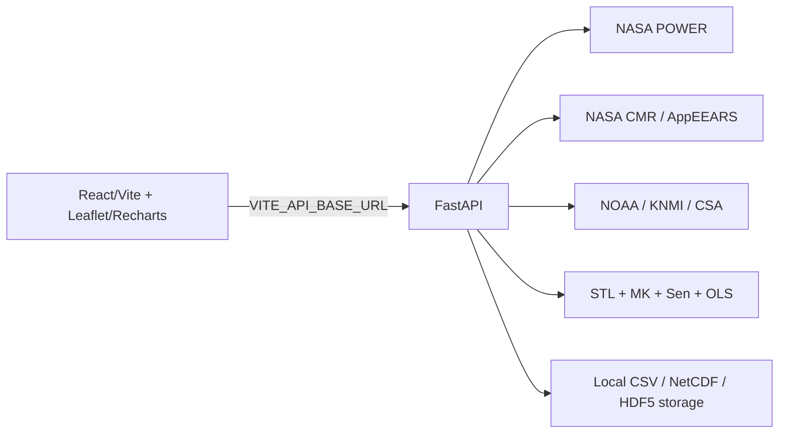

# TerraShift Technical Audit

Audit date: 2026-11-15. Scope: repository at `D:\TerraShift`, deployed frontend at `distinguished-wisdom-production.up.railway.app`, and its configured Railway API.

## Executive result

The project builds and its 30 existing backend tests pass, but it is **not ready to claim complete NASA challenge compliance**. Live API investigation works for a representative coordinate; regional acquisition and production hardening remain incomplete.

## Architecture

There is no database; persistence is local JSON/CSV/filesystem. This is unsuitable as durable shared production storage and has no locking.

## Confirmed findings

| Priority | Finding | Evidence and impact | Recommended fix |
|---|---|---|---|
| P1 | Public resource-consuming endpoints have no authentication, authorization, rate limit, request-size cap, or job queue. | `backend/main.py:348-374`, `412-425`, `819`, `1016`, `1150`; MK and Sen both materialize O(n²) arrays in `backend/stats_engine.py:133-134,199-200`. A large `/api/analyze` or `/api/import-series` request can exhaust RAM/CPU; `/download` can consume outbound bandwidth/disk and upstream credentials. | Cap samples and raw import bytes, rate-limit, protect acquisition/Gemini routes, and run downloads in a bounded background queue. |
| P1 | Copernicus “download” is not implemented. | `backend/main.py:1221-1234` returns `ready_via_cds_client` and a message telling an operator to invoke a Python method; it never calls it. UI therefore cannot acquire configured CDS data. | Call `download_cds_dataset`, validate/QC/subset it, and add an integration test with a mocked CDS client. |
| P1 | Production acquisition state is local filesystem/CSV with unsafe concurrent read-modify-write. | `manifest_manager.py:92`, `135-138`, `168-170`; Render/Railway containers are ephemeral and multiple workers can lose/corrupt rows. | Use object storage plus transactional metadata store (or a single-writer queue); atomic replace and locking for interim local mode. |
| P2 | Production reports `environment: development`. | Live `GET /api/status` returned that value; `backend/main.py:603`. This can expose development behavior/status and makes release provenance unclear. | Set `ENVIRONMENT=production`; ensure reload/debug behavior is disabled and expose a deployment revision. |
| P2 | Frontend production bundle is large. | `npm run build`: 936.97 kB uncompressed / 255.87 kB gzip JS; Vite emitted chunk warning. | Route/component lazy-load maps, charts, acquisition UI; inspect bundle before tuning chunks. |
| P2 | Modal history can reopen a completed import on Back. | Import modal pushes a `modal: import` entry (`App.tsx:547-552`); successful analysis pushes `analysis` (`402-435`, `526-529`). Browser Back returns to modal state, reopening it. | Replace the modal state on successful import, or consume it using `history.back()` before pushing analysis; add browser regression coverage. |
| P3 | Vercel rewrite sends every same-origin path to `index.html`. | `vercel.json:6-11`. If `VITE_API_BASE_URL` is absent/misconfigured, `/api/*` returns HTML rather than an API error. | Add explicit `/api/(.*)` proxy/rewrite or make deployment fail when API URL is absent. |

## Verification performed

- `python -m pytest -q backend/tests`: **30 passed**.
- `npm run build` in `frontend`: **passed**.
- Local API: health/cases/CORS OPTIONS verified.
- Live frontend HTML: HTTP 200, 754 B, expected title.
- Live API: health/status/cases and a valid investigation tested. Invalid investigation returned structured 422.

## Not verified

The available browser automation host was unavailable, so no browser-console/network crawl, interactive-control inventory, accessibility-tree audit, visual/mobile/cross-browser test, or screenshot evidence was possible. No clean E2E suite/Playwright configuration exists in the repository.
